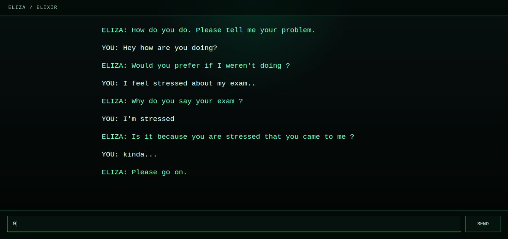

<h1 align="center">ELIZA</h1>

  <b>A High-Fidelity Reconstruction of the 1966 DOCTOR Script</b>

  <i>"I had not realized... that extremely short exposures to a relatively simple computer program could induce powerful delusional thinking in quite normal people."</i>
   — <b>Joseph Weizenbaum</b>, 1966

  
  
  

---

### Abstract
This project is a multi-language reconstruction of Joseph Weizenbaum’s **ELIZA**. By implementing the original **DOCTOR** script in Elixir, Go, and Rust, we explore the boundary between pattern-matching and perceived intelligence. ELIZA does not understand; it transforms input through a disciplined 7-step pipeline, mirroring human perspective to create the "ELIZA Effect."

  

### The Core
*   **Historical Parity** – Strict adherence to 1966 logic and greedy matching.
*   **Polyglot Engines** – Unified logic across functional and imperative paradigms.
*   **Modular Scripts** – Decoupled JSON-based "personalities."

### The Pipeline
*Normalization* → *Keyword Scan* → *Decomposition* → *Reassembly* → *Substitution* → *Reflection* → *Output*

### Perspectives
- **Elixir** — Explores functional state and recursive flow through process-based actors.
- **Go** — Focuses on structural simplicity and explicit concurrency for web-scale delivery.
- **Rust** — Emphasizes strict type safety and memory ownership for robust pattern matching.

### Structure
| Path | Description |
| :--- | :--- |
| [`/implementations`](implementations/) | The three engine implementations (Elixir, Go, Rust). |
| [`/data`](data/) | Shared JSON scripts (keywords, rules, synonyms). |
| [`/docs`](docs/) | Technical specifications, architecture, and research. |
| [`/reference`](reference/) | Historical archives and original transcriptions. |

---

  <a href="docs/guides/run-guide.md">Run Guide</a> • 
  <a href="docs/research/README.md">Research Hub</a> • 
  <a href="docs/README.md">Documentation</a>

  <i>Crafted by Team Marie Curie. Driven by historical curiosity.</i>

